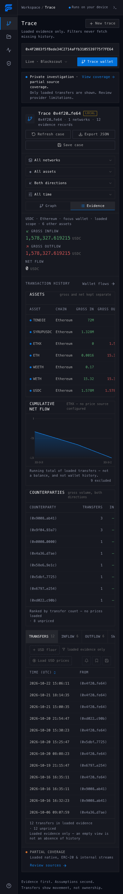

<p align="center">
  <picture>
    <source media="(prefers-color-scheme: dark)" srcset="docs/images/flowlens-logo-dark.png" />
    
  </picture>
</p>

<p align="center">
  <strong>Free, open-source wallet tracing for people and their agents.</strong><br />
  Follow the money on Ethereum and Derive Chain, keep every transfer as evidence, and run it all on your own computer.
</p>


_A live trace of the ENS DAO endowment ([endowment.ensdao.eth](https://eth.blockscout.com/address/0x4F2083f5fBede34C2714aFfb3105539775f7FE64)), loaded from Blockscout's public explorer with no API key on 23 October 2026._

## Why FlowLens

Blockchain data is public, but the tools that make it readable are often paid, hosted and closed. If you used a hosted tracer such as Arkham and want something free that you control, FlowLens is for you.

- **Free and open source** under the AGPL. No account, no subscription, no telemetry.
- **Runs on your machine.** Your cases, notes and labels stay local.
- **No API key needed** for Ethereum or Derive Chain history.
- **Evidence first.** Every line on the graph opens the transfers behind it, with the transaction, block, time and source. Gaps in coverage are shown, not hidden.
- **Built for agents too.** The same engine is available as a CLI, a local HTTP API and an MCP server, so an AI assistant can trace wallets and save its work where you can check it.

FlowLens keeps improving as we learn new ways to follow funds. See the [roadmap](#roadmap).

## Get started

You need [Node.js](https://nodejs.org) 24.12 or newer and a modern browser.

```sh
git clone https://github.com/tobenwarrior/FlowLens.git
cd FlowLens
npm ci --ignore-scripts
npm run build
npm start
```

Open **http://127.0.0.1:4319**. Paste any Ethereum address and press **Trace wallet**, or pick one of the public wallets on the start screen. The server only listens on your own computer.

## Reading a trace

1. **The funding graph.** Wallets that sent money to your focus wallet sit on the left; wallets it paid sit on the right. Each line groups the transfers between two wallets.
2. **Follow a connection.** Select a wallet to see its inflows, outflows and counterparties, or select a line for the exact transfers. **Expand wallet** loads another page of that wallet's history, so you can walk the trail one hop at a time. Choose **Derive** as the expansion network to follow a wallet onto Derive Chain.
3. **Filter what's loaded.** Narrow by network, asset, direction or date. Filters only work on history you have already loaded; they never fetch more behind your back.
4. **Label what you learn.** Attach a name to a wallet with its source, date and confidence. FlowLens remembers it and fills it in on later traces.
5. **Keep the case.** Add notes, save the investigation, or export it as JSON to share or reopen later.

On a phone, the **Evidence** view lists assets, net flow over time, counterparties and every transfer:

<details>
<summary>Phone view</summary>



</details>

A few habits keep a trace honest:

- **Transfers show movement, not ownership.** A shared funder or a nearby wallet does not prove two wallets belong to the same person.
- **Gross flow isn't profit.** Inflow, outflow and net are kept separate per asset; transfers aren't automatically buys or sells.
- **Loaded history is partial.** History arrives a page at a time, newest first. An empty result means nothing is loaded yet, not that nothing happened. **Sources & coverage** shows exactly what each page covered.
- **Well-known wallets attract spam.** Unsolicited airdropped tokens are common; filter by asset to focus on real flows.

## What it can do today

| Area           | What you get                                                                                                                                                                       |
| -------------- | ---------------------------------------------------------------------------------------------------------------------------------------------------------------------------------- |
| Wallet history | ETH, ERC-20 and internal transfers on Ethereum and Derive Chain from Blockscout, no key needed. With your own Etherscan key: ETH and ERC-20 transfers on Ethereum and Arbitrum One |
| Graph          | Directional funding graph with expansion, zoom and pan, pin, hide and restore, grouping by type, and network, asset, direction and date filters                                    |
| Wallet flows   | Per-asset gross in, gross out and net; counterparties; transfer history with inflow, outflow and swap views; cumulative net-flow chart                                             |
| Evidence       | Exact amounts, transaction hash, block, UTC time, provider and retrieval time for every transfer, with explorer links                                                              |
| Labels         | Wallet names with source, confidence and claim type, remembered across investigations                                                                                              |
| Prices         | Optional USD values from Uniswap V3 pools over a public RPC; prices at transfer time with your Etherscan key                                                                       |
| Protocol reads | On request: Safe configuration and history, Circle CCTP bridge transactions, and single-transaction call traces, kept separate from graph totals                                   |
| Agents         | JSON CLI, local HTTP API and 20 stdio MCP tools, all sharing one case store                                                                                                        |

On Derive Chain, subaccount collateral, positions and trades are records inside Derive's own contracts, not wallet transfers. A Derive trace shows the deposits, withdrawals and other transfers that touch the address, not subaccount balances or trading.

FlowLens never connects a wallet, signs transactions or holds funds.

## Use it from an agent

The CLI runs the same engine without a browser. Each command prints JSON.

```sh
node server/cli.ts create --mode live --title "ENS DAO endowment" \
  --address 0x4F2083f5fBede34C2714aFfb3105539775f7FE64 --file .local/endowment.json
node server/cli.ts wallet --file .local/endowment.json \
  --address 0x4F2083f5fBede34C2714aFfb3105539775f7FE64 --page-size 25
node server/cli.ts expand --file .local/endowment.json \
  --address 0x4F2083f5fBede34C2714aFfb3105539775f7FE64 --chain 1 --pages 1
node server/cli.ts inspect --file .local/endowment.json
```

Use `--chain 957` with `expand` to follow a wallet on Derive Chain. `create` won't overwrite an existing file; resume a case with `expand` or `inspect`. Exit code `2` means a provider failed but everything already loaded was kept, so check the coverage it reports.

For MCP, launch `node server/mcp.ts` from your MCP host. Start with `flowlens_status`, then create a case:

```json
{
  "name": "flowlens_create",
  "arguments": {
    "root": "0x4F2083f5fBede34C2714aFfb3105539775f7FE64",
    "mode": "live",
    "title": "ENS DAO endowment"
  }
}
```

Use the returned `result.id` as `caseId` for the other tools. The [MCP guide](docs/mcp.md) covers setup and all 20 tool contracts; [wallet controls](docs/workspace-controls.md) covers labels and visibility from the CLI, API and MCP.

The browser, API and MCP server share cases in `.local/cases` and labels in `.local/labels.json`. Set `FLOWLENS_DATA_DIR` and `FLOWLENS_LABEL_FILE` to absolute paths when your MCP host launches from another directory.

## Privacy

FlowLens has no telemetry and no account. What does leave your computer:

- **The address you trace** goes to Blockscout (`eth.blockscout.com`), or to Etherscan if you set your own key. Following a wallet on Derive Chain sends it to Derive's public explorer (`explorer.derive.xyz`), with or without a key. Set `FLOWLENS_BLOCKSCOUT=off` to stop queries to both explorers; Derive history is then unavailable.
- **Price lookups**, only when you press **Load USD prices**, go to a public Ethereum RPC, and to Etherscan for prices at transfer time.
- **Protocol reads** (Safe, CCTP, call traces) go to fixed public services, only when you ask for them.

Cases and browser storage are **not encrypted**. Exports can contain sensitive research, so share them deliberately. See [SECURITY.md](SECURITY.md).

### Optional Etherscan key

A key adds Arbitrum One, but it also moves Ethereum history to Etherscan, which returns ETH and ERC-20 transfers without internal ones. Derive Chain stays on Blockscout, because Etherscan has no Derive history. To use it, copy `.env.example` to `.env`, add your own Etherscan V2 key, and start the server with:

```sh
node --env-file=.env server/index.ts
```

The key stays on the server and is never sent to the browser. [Provider coverage](docs/providers.md) explains what each source covers and its limits.

## Roadmap

FlowLens grows as we learn more about following funds on-chain. Next up:

- **More chains**, as their explorers open up keyless access.
- **Better tracing techniques**, added as we learn them.

If there's a wallet you can't follow, or a pattern FlowLens should recognise, [open an issue](https://github.com/tobenwarrior/FlowLens/issues).

## Develop and contribute

For development, keep `npm start` running for the API and run `npm run dev` in a second terminal, then open http://127.0.0.1:4318.

```sh
npm run lint
npm run typecheck
npm run format:check
npm run build
npm run release:check
```

The test suite is kept outside this repository. Live checks are recorded in [live verification](docs/live-verification.md).

Read [CONTRIBUTING.md](CONTRIBUTING.md) before changing how evidence is counted, and [architecture](docs/architecture.md) for how the pieces fit.

## License

FlowLens is free software: you can redistribute it and/or modify it under the terms of the [GNU Affero General Public License, version 3](LICENSE) (`AGPL-3.0-only`). Copyright © 2026 tobenwarrior.

If you run a modified FlowLens and let other people use it over a network, AGPL section 13 requires you to offer them the source of your version. That is deliberate: a hosted or paid fork has to stay open.

The code license covers FlowLens itself. It does not grant rights to provider responses, third-party labels (Arkham's included), anyone's investigations or label packs; a public blockchain record does not settle a provider dataset's terms. FlowLens includes no Arkham data and does not scrape any service. Dependency licenses and required notices are in [third-party notices](THIRD_PARTY_NOTICES.md), and the reasoning behind the choice is in the [license decision](docs/license-options.md).
