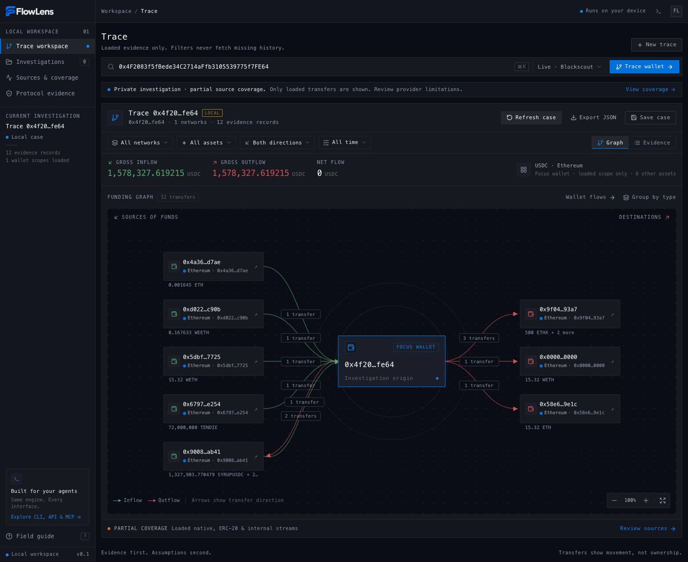
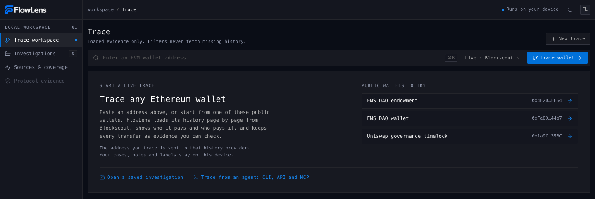
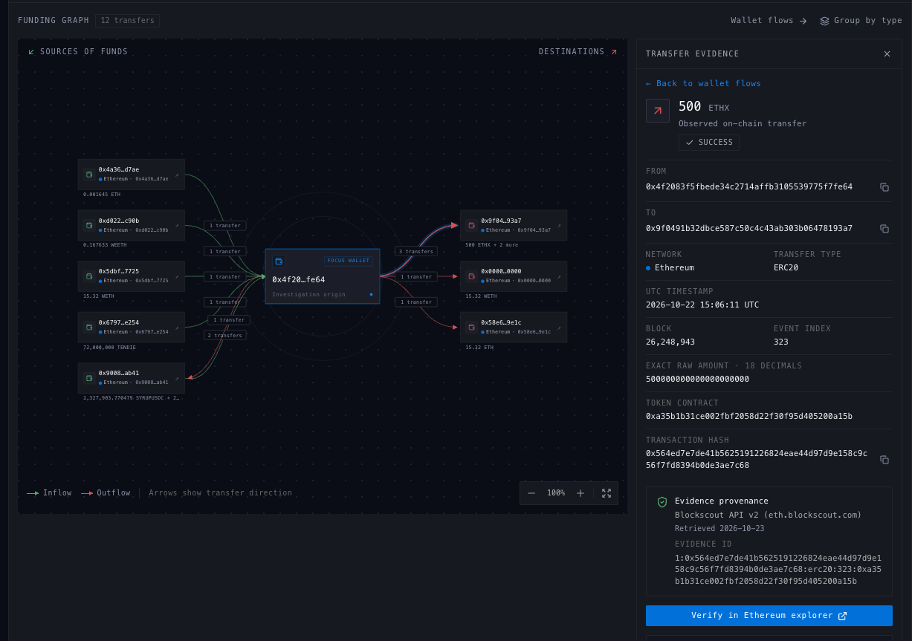
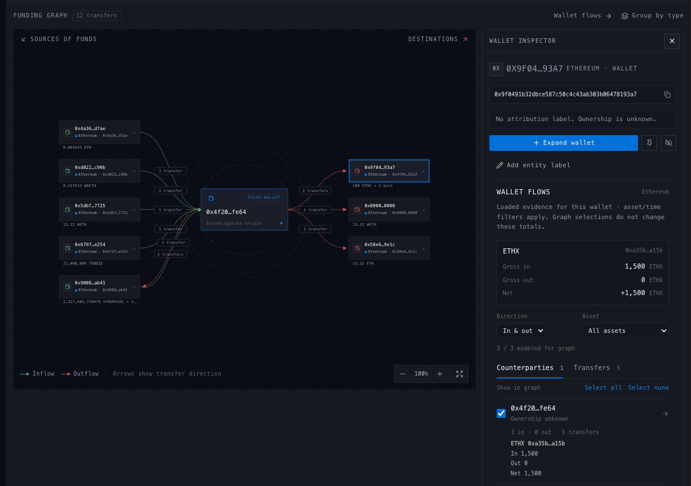
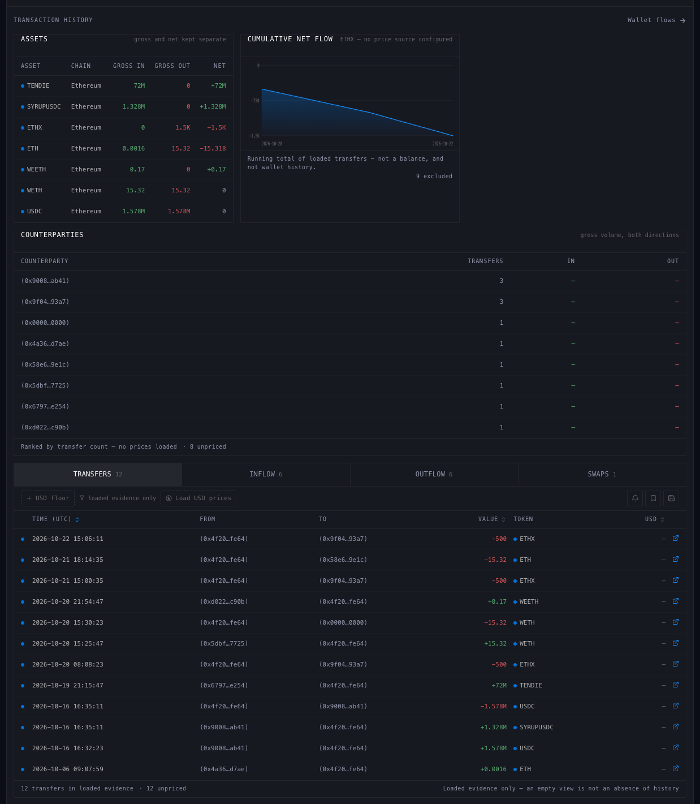
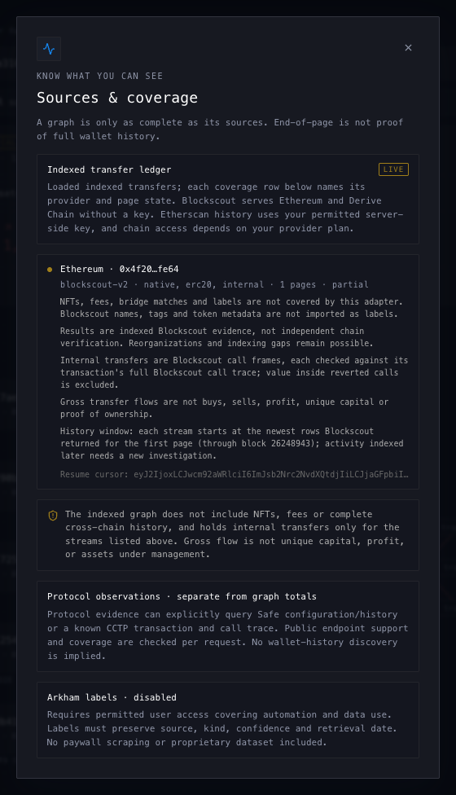
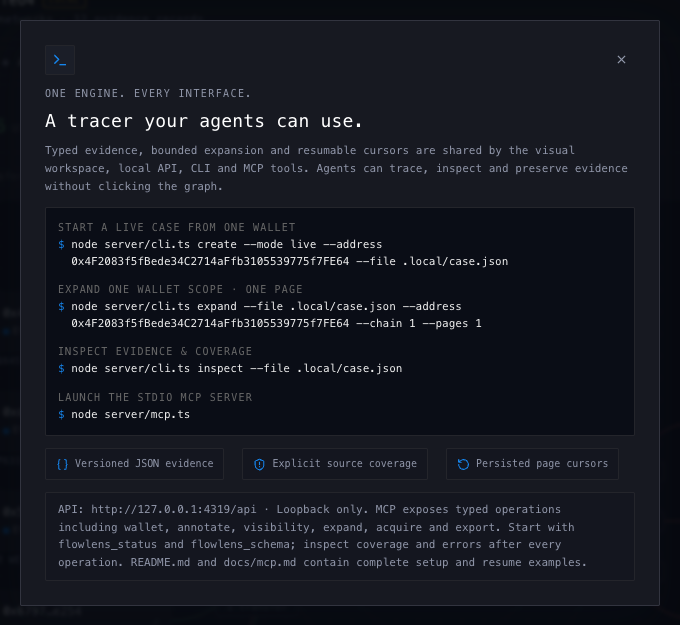

<p align="center">
  <picture>
    <source media="(prefers-color-scheme: dark)" srcset="docs/images/flowlens-logo-dark.png" />
    
  </picture>
</p>

<p align="center">
  <strong>Follow the funds. Keep the evidence.</strong><br />
  Open-source EVM wallet tracing, built for people and their agents.
</p>

<p align="center">
  <a href="#get-started">Get started</a> ·
  <a href="#what-it-can-do-today">Features</a> ·
  <a href="#use-it-from-an-agent">Agents</a> ·
  <a href="#documentation">Documentation</a>
</p>



_ENS DAO endowment example, loaded from Blockscout without an API key on 23 October 2026. Screenshots use public-wallet examples, not private investigations. [Sources and scope](docs/images/README.md)._

## Why FlowLens

Blockchain data is public. Your investigation should stay under your control.

- **Local-first.** Run on your computer; keep cases, notes and labels local. No telemetry.
- **Evidence you can inspect.** Open a connection to see the transfers, exact amounts, source and transaction links behind it.
- **Coverage you can see.** Missing streams, partial history and provider errors stay visible.
- **Human and agent workflows.** Use the visual workspace, JSON CLI, local HTTP API or 20-tool MCP server.
- **Free and open source.** AGPL-3.0-only. No wallet connection, signing or custody.

## Get started

Requires **Node.js 24.12+** and a modern browser.

```sh
git clone https://github.com/tobenwarrior/FlowLens.git
cd FlowLens
npm ci --ignore-scripts
npm run build
npm start
```

Open **http://127.0.0.1:4319**, paste an Ethereum address and select **Trace wallet**. You can also choose a public example from the start screen.

Ethereum and Derive Chain history need **no API key**. The server listens on your computer only; do not expose the unauthenticated API to an untrusted network.

## What it can do today

| Capability        | What you get                                                                                                        |
| ----------------- | ------------------------------------------------------------------------------------------------------------------- |
| Funding graph     | Follow incoming and outgoing transfers; expand one wallet at a time, filter, group, pin or hide nodes.              |
| Wallet analysis   | Per-asset gross inflow, outflow and net; ranked counterparties, transfer history and cumulative net-flow charts.    |
| Evidence          | Exact raw amounts, transaction hashes, blocks, UTC timestamps, token contracts and provider provenance.             |
| Labels and cases  | Save investigations, add sourced labels and notes, and export or reopen case JSON.                                  |
| USD prices        | Optional current values from Uniswap V3 over public RPC; historical prices with your Etherscan key.                 |
| Protocol evidence | Bounded Safe reads, Circle CCTP bridge transactions and single-transaction call traces, separate from graph totals. |
| Reports           | Agent workflows for source-cited PDF, Word and HTML reports with reviewed screenshots.                              |

### Supported history sources

| Network      | Chain ID | Default history source                         | API key      |
| ------------ | -------- | ---------------------------------------------- | ------------ |
| Ethereum     | 1        | Blockscout: ETH, ERC-20 and internal transfers | Not required |
| Derive Chain | 957      | Blockscout: ETH, ERC-20 and internal transfers | Not required |
| Arbitrum One | 42161    | Etherscan V2: ETH and ERC-20 transfers         | Required     |

An Etherscan key also switches Ethereum history to Etherscan, without internal transfers. Derive stays on Blockscout. [Provider coverage and limits](docs/providers.md).

Derive subaccount collateral, positions and trades are not wallet transfers; a wallet trace does not reconstruct those balances or trading activity.

> **A trace is evidence of movement, not proof of ownership.** Gross flow is not profit. Loaded history is partial, and labels or shared counterparties do not establish who controls a wallet.

## How it works

1. **Start with a wallet.** Load the newest history page, then follow a specific counterparty with **Expand wallet**. Choose Derive as the expansion network to follow an address there.
2. **Inspect the evidence.** Select a connection or wallet to examine individual transfers and per-asset flows. Filter by network, asset, direction or date; filters never fetch more history.
3. **Check coverage and save.** Review **Sources & coverage** for loaded streams, missing data and resume cursors. Add notes or labels, then save or export your case.

<details>
<summary><strong>Explore the workspace</strong> — screenshots</summary>

### Start a trace



### Inspect a connection



### Follow a wallet



### Review history



### Understand coverage



### Connect an agent



</details>

## Use it from an agent

The CLI, local HTTP API and stdio MCP server share the same evidence engine and case store.

### CLI

Each command returns JSON. Create a case, load one page, then inspect it:

```sh
node server/cli.ts create --mode live --title "ENS DAO endowment" \
  --address 0x4F2083f5fBede34C2714aFfb3105539775f7FE64 --file .local/endowment.json
node server/cli.ts expand --file .local/endowment.json \
  --address 0x4F2083f5fBede34C2714aFfb3105539775f7FE64 --chain 1 --pages 1
node server/cli.ts inspect --file .local/endowment.json
```

Use `--chain 957` to expand on Derive. `create` will not overwrite a case; resume it with `expand` or `inspect`. Exit code `2` means a provider failed; retained evidence and coverage explain what was loaded.

### MCP

Launch `node server/mcp.ts` from your MCP host and start with `flowlens_status`. The [MCP guide](docs/mcp.md) covers setup and all 20 tool contracts.

Cases live in `.local/cases`; labels in `.local/labels.json`. If the host launches outside the repository, set absolute `FLOWLENS_DATA_DIR` and `FLOWLENS_LABEL_FILE` paths.

### Investigation skills

| Workflow                                                             | Purpose                                                                                                                                              |
| -------------------------------------------------------------------- | ---------------------------------------------------------------------------------------------------------------------------------------------------- |
| [Trace a wallet](skills/investigation/trace-wallet/SKILL.md)         | Follow funding, classify counterparties and build an attribution case with explicit uncertainty.                                                     |
| [Review a cluster](skills/investigation/cluster-wallets/SKILL.md)    | Examine dedicated deposit-address leads; stop indiscriminate expansion through pooled exchanges. Bounded review, not automatic ownership clustering. |
| [Audit evidence](skills/investigation/audit-trace-evidence/SKILL.md) | Check event identity, provenance, coverage gaps and what a conclusion actually establishes.                                                          |
| [Create a report](skills/reporting/report-investigation/SKILL.md)    | Turn reviewed evidence and screenshots into cited PDF, Word or HTML documents.                                                                       |

Start at the [skill index](skills/README.md), or read the [tracing method](skills/investigation/trace-wallet/references/tracing-method.md).

## Privacy

**Local-first does not mean offline.** Requested identifiers go to the services needed to answer your query:

- **Wallet history:** Blockscout on Ethereum and Derive; Etherscan when configured on Ethereum or Arbitrum.
- **USD prices:** public Ethereum RPC and, for historical prices, Etherscan. Lookups run when you select **Load USD prices**.
- **Protocol reads:** fixed public RPC and protocol services, only when requested.

Cases and browser storage are **not encrypted**. Exports can contain sensitive research; review them before sharing. Set `FLOWLENS_BLOCKSCOUT=off` to disable both Blockscout history routes; Derive history is then unavailable. See [SECURITY.md](SECURITY.md).

### Optional Etherscan key

Copy `.env.example` to `.env`, add your Etherscan V2 key, then start the server with:

```sh
node --env-file=.env server/index.ts
```

The key stays server-side and is never sent to the browser. Keys and private case files do not belong in Git.

## Documentation

- [Provider coverage](docs/providers.md) — networks, streams, pagination and limits.
- [MCP guide](docs/mcp.md) — agent setup and tool contracts.
- [Workspace controls](docs/workspace-controls.md) — labels, notes and wallet visibility.
- [Protocol acquisition](docs/acquisition.md) — bounded Safe, CCTP and call-trace workflows.
- [Investigation reports](docs/investigation-reports.md) — report bundles, screenshots and document exports.
- [Architecture](docs/architecture.md) — the shared engine and evidence boundaries.

## Roadmap

- Broader EVM history coverage, through explorers and providers that support it.
- Better tracing and attribution methods as we learn, with evidence and uncertainty kept explicit.

Missing a network or tracing workflow? [Open an issue](https://github.com/tobenwarrior/FlowLens/issues).

## Develop and contribute

Keep `npm start` running for the API, then run `npm run dev` in a second terminal and open **http://127.0.0.1:4318**.

```sh
npm run lint
npm run typecheck
npm run format:check
npm run skills:check
npm test
npm run build
npm run release:check
```

`npm test` always runs offline synthetic smoke checks. A local ignored `tests/` suite runs when present; tests do not certify live-provider availability or complete history.

Read [CONTRIBUTING.md](CONTRIBUTING.md) before changing evidence behavior or preparing a release.

## License

**AGPL-3.0-only** · Copyright © 2026 tobenwarrior. See [LICENSE](LICENSE) and [third-party notices](THIRD_PARTY_NOTICES.md).

Modified versions offered over a network must provide corresponding source under AGPL section 13. The code license does not grant rights to provider data, third-party labels or private investigations.
